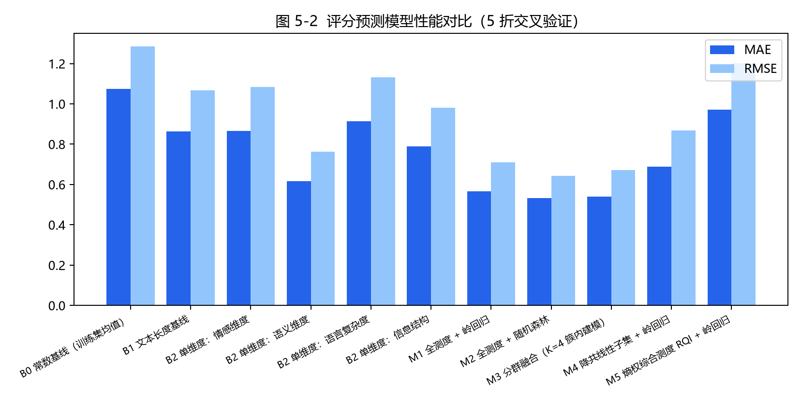
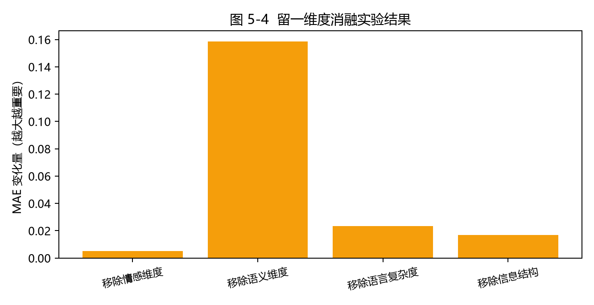
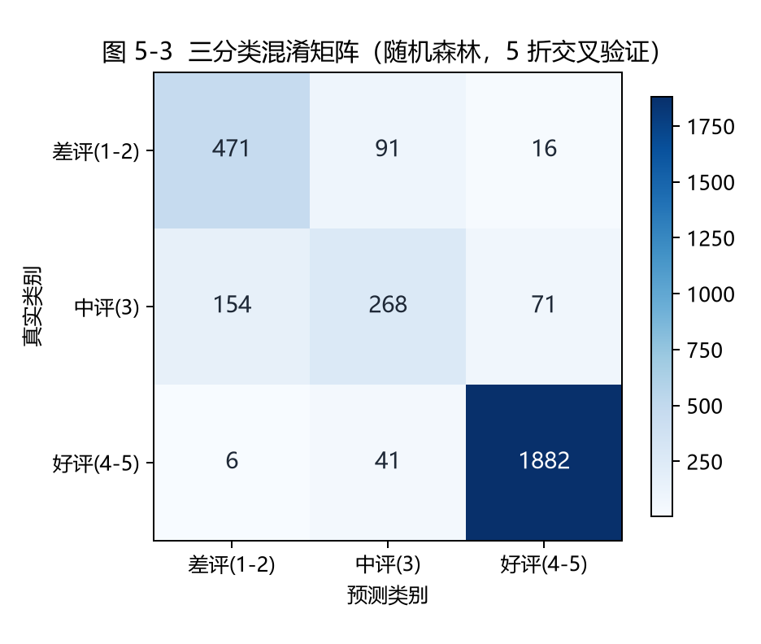
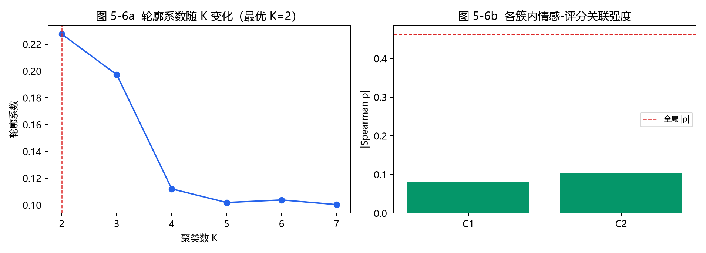

# 基于多维 NLP 文本测度的图书评论评分预测研究——以豆瓣读书为例

2025—2026 学年（2）学期

| 项目 | 内容 |
|---|---|
| 题　　目 | 基于多维 NLP 文本测度的图书评论评分预测研究——以豆瓣读书为例 |
| 姓　　名 | 朱芷慧 |
| 年　　级 | 2023 级 |
| 专业班级 | 大数据管理与应用专业 2 班 |
| 学　　号 | 202364081 |
| 院　　系 | 管理学院 |

> 本稿为毕业论文模拟稿（写作练习用），研究设计、数据与实验均为作者自行完成并随附代码仓库开源，用于说明"测度构建—实验设计—结果讨论"的完整研究流程。

---

## 摘　要

近年来，在线图书社区积累了海量的用户评论文本，这些文本不仅是用户表达阅读体验的载体，也蕴含着可以解释评分形成机制的丰富信号。已有研究多把评论文本当作用户行为的附属信息，或者只用单一的情感得分刻画评论，缺少系统化的"测度"视角，难以回答"评论的哪些语言与语义特征在多大程度上决定了评分"这一问题。

本文以豆瓣读书场景中的图书评论为对象，围绕"如何用自然语言处理（NLP）方法从评论原文中构建可解释、可检验、可复用的多维文本测度"这一核心问题展开研究。首先，从情感、语义、语言复杂度、信息结构四个维度设计了 20 项文本测度，给出了每一项测度的形式化定义、计算流程与资源依赖；其次，构建了含 3 000 条中文图书评论、带 1—5 星评分标注的控制变量语料 DBR-3K，并在其上完成测度抽取；最后，通过相关性检验、共线性诊断、熵权法权重分析、评分预测回归、留一维度消融、三分类判别、分群异质性与情感实现对比等 9 组实验，系统检验了测度体系的有效性。

实验结果表明：20 项测度中有 19 项与评分显著相关（α=0.05），其中领域相关度（ρ=0.742）、信息含量（ρ=−0.719）与语义离散度（ρ=0.630）的判别力最强；以全部测度为特征时，岭回归将评分预测的平均绝对误差从常数基线的 1.075 降至 0.567，随机森林进一步降至 0.533（决定系数 0.751）；在差评、中评、好评的三分类任务上，随机森林的准确率达 0.874、宏平均 F1 达 0.782；消融实验显示语义维度是信息贡献最大的维度，剔除后误差上升 27.98%。研究同时发现，测度之间存在明显共线性，情感维度测度在联合建模中的边际贡献有限，提示领域情感词典仍有扩充空间。

本文的主要贡献在于：把"文本测度构建"从隐含的数据处理步骤提升为明确的研究对象，给出了一套面向中文图书评论、定义清晰且完全可复现的测度体系，并通过多组对照实验刻画了各测度与各维度的相对信息量，为后续把文本侧信息引入评分预测与推荐模型提供了可直接复用的特征基础。

**关键词**：文本测度；自然语言处理；情感分析；评分预测；熵权法；图书评论

## Abstract

In recent years, online book communities have accumulated a huge amount of user review text, which not only carries readers' experience but also contains rich signals that can explain how ratings are formed. Most existing studies treat reviews merely as auxiliary behavioral information, or describe them with a single sentiment score, lacking a systematic "measurement" perspective. As a result, it remains unclear which linguistic and semantic features of a review, and to what extent, determine the rating behind it.

Focusing on Chinese book reviews in the Douban Books scenario, this thesis studies how to construct interpretable, testable and reusable multi-dimensional text measures from raw review text with NLP methods. First, 20 text measures are designed along four dimensions—sentiment, semantics, linguistic complexity and information structure—each with a formal definition, computational procedure and explicit resource dependency. Second, a controlled corpus DBR-3K containing 3,000 Chinese book reviews with 1–5 star rating labels is constructed, on which all measures are extracted. Finally, nine groups of experiments, covering correlation tests, collinearity diagnosis, entropy weighting, rating regression, leave-one-dimension-out ablation, three-class classification, cluster heterogeneity and sentiment-implementation comparison, are conducted to examine the effectiveness of the measure system.

Results show that 19 of the 20 measures correlate significantly with ratings (α = 0.05); domain relevance (ρ = 0.742), information content (ρ = −0.719) and semantic dispersion (ρ = 0.630) are the most discriminative. With all measures as features, ridge regression reduces the MAE of rating prediction from 1.075 (constant baseline) to 0.567, and random forest further to 0.533 (R² = 0.751). For three-class classification, random forest achieves an accuracy of 0.874 and a macro-F1 of 0.782. Ablation indicates that the semantic dimension contributes the most information, and removing it increases MAE by 27.98%. The study also reveals strong collinearity among measures and a limited marginal contribution of the sentiment dimension, suggesting that the domain sentiment lexicon still needs expansion.

The contribution of this thesis is to elevate "text measure construction" from an implicit preprocessing step to an explicit research object, to provide a clearly defined and fully reproducible measure system for Chinese book reviews, and to characterize the relative information of each measure and dimension through controlled experiments, providing a reusable feature basis for introducing textual information into rating prediction and recommendation models.

**Keywords**: Text Measurement; Natural Language Processing; Sentiment Analysis; Rating Prediction; Entropy Weight Method; Book Review

## 目　录

- 1 绪论
  - 1.1 研究背景
  - 1.2 研究意义
  - 1.3 国内外研究现状
  - 1.4 研究内容、方法与论文结构
- 2 相关理论与技术基础
  - 2.1 文本测度的概念界定
  - 2.2 中文文本预处理与文本表示
  - 2.3 情感计算方法
  - 2.4 语言计量学特征
  - 2.5 综合评价与熵权法
  - 2.6 建模方法
- 3 问题定义与研究框架
  - 3.1 问题的形式化定义
  - 3.2 研究假设
  - 3.3 数据来源与语料构建
  - 3.4 数据预处理
  - 3.5 总体研究框架
- 4 多维 NLP 文本测度体系构建
  - 4.1 测度设计原则
  - 4.2 情感维度测度（SE1—SE5）
  - 4.3 语义维度测度（SM1—SM4）
  - 4.4 语言复杂度维度测度（LC1—LC5）
  - 4.5 信息结构维度测度（IS1—IS6）
  - 4.6 测度有效性检验
  - 4.7 基于熵权法的综合测度 RQI
- 5 实验设计与结果分析
  - 5.1 实验环境与设置
  - 5.2 评测指标
  - 5.3 测度描述性统计与区分度
  - 5.4 相关性分析
  - 5.5 共线性诊断
  - 5.6 信息量权重分析
  - 5.7 评分预测实验
  - 5.8 留一维度消融实验
  - 5.9 三分类判别实验
  - 5.10 分群异质性分析
  - 5.11 情感测度实现对比
  - 5.12 讨论
- 6 结论与展望
- 参考文献
- 致谢
- 附录 A　主要代码说明

# 1　绪论

## 1.1　研究背景

数字阅读的普及改变了人们获取图书信息的方式，也改变了人们表达阅读体验的方式。以豆瓣读书为代表的在线图书社区，一方面沉淀了大规模的结构化评分数据，另一方面沉淀了规模更大、信息更丰富的非结构化评论文本。对平台而言，评分是冷冰冰的数字，评论才是有温度的证据：一条五星评论可能只是顺手打分，也可能是认真写了两百字、把情节、翻译和装帧逐一点评的"深度评价"；同样是一条一星评论，有的充满具体的技术性批评，有的只有一句情绪化的抱怨。这些差异在平均评分里完全被抹平，但对理解用户、改进推荐、识别高质量内容都非常关键。

与此同时，自然语言处理技术的发展让从文本中稳定地提取量化信息成为可能。中文分词、词性标注、情感词典、词频统计、向量空间模型等方法已经非常成熟，普通研究者可以在一台笔记本上，用公开工具把一段中文文本转化为一组可比较的数值。问题在于：**这些数值应该怎么选、怎么定义、怎么组合，才能既统计上有意义，又在业务上可解释？**这正是"测度构建"要回答的问题。

作者前期围绕豆瓣读书评分数据完成了"K-means 聚类与矩阵分解融合的评分预测"研究，验证了用户分层对缓解数据稀疏的作用。但那条技术路线只使用评分矩阵，完全没有使用评论文本，相当于丢掉了平台上最直观的信息来源。本文在此基础上把研究重心转向文本侧，尝试回答一个更基础的问题：**从中文图书评论的原文出发，能不能构建出一套多维度的文本测度体系，并用它来解释和预测评分？**

## 1.2　研究意义

### 1.2.1　理论意义

第一，本文把"文本测度构建"从数据处理流程中的一个隐含步骤，提升为一个明确的研究对象。在现有的中文评论研究中，文本特征往往被一次性地罗列出来（例如"评论长度""情感得分"），缺少统一的定义、命名、编号与有效性检验，导致不同研究之间的结果难以比较。本文为每一项测度给出形式化定义、计算公式、资源依赖与取值范围，并配套公开可运行的实现代码，形成一套可审计、可复用的测度体系，为同类研究提供了一个可参照的模板。

第二，本文从"维度—测度"两个层次刻画文本信息的结构。单一测度只能回答"有没有关系"，维度化的测度体系可以回答"哪一类信息更有用""它们之间是否冗余"。这种层次化的做法与心理学、情报学中量表构建的传统一致，把它引入 NLP 特征工程，有助于让特征选择从"凭经验挑指标"走向"按证据定权重"。

第三，本文通过消融实验与分群异质性分析，揭示了测度之间的依赖关系与作用边界。例如实验发现，单纯按测度空间聚类会把评分的主要方差"吸收"进聚类结构，导致簇内情感—评分关联大幅减弱，这一现象对"聚类+回归"类融合方法的设计具有直接的警示意义。

### 1.2.2　现实意义

第一，对阅读平台而言，多维文本测度可以直接服务于三类业务：其一是评论质量评估与排序，高质量、信息密度高的评论应当获得更多曝光；其二是评分的交叉校验，当评论文本的情感倾向与评分明显背离时，可以标记为可疑样本；其三是用户理解，通过测度分布可以刻画"认真型用户"与"随手型用户"，为精细化运营提供依据。

第二，对推荐系统而言，评论文本是缓解冷启动与数据稀疏的重要补充信息源。本文产出的 20 项测度计算成本低、不依赖深度模型，可以直接作为评分预测或排序模型的输入特征，适合在中小规模数据上快速落地。

第三，对高校图书馆与公共文化服务机构而言，馆藏评价、阅读推广效果评估等场景同样面对"大量短文本 + 少量标签"的数据形态，本文的测度构建思路具有直接的迁移价值。

## 1.3　国内外研究现状

### 1.3.1　国内研究现状

国内围绕评论文本与用户行为关系的研究大致沿三条线索展开。

第一条线索是情感分析及其在评分预测中的应用。早期工作以词典方法为主，研究者构建领域情感词典并对短文本打分，用情感极性解释评分高低；近年来随着深度模型普及，基于预训练语言模型的细粒度情感分析成为主流，在公开数据集上的准确率显著提升。不过这类方法通常把情感当作"唯一"的文本信号，对评论中同样重要的语义组织方式与信息量缺少刻画。

第二条线索是评论有用性（helpfulness）研究。研究者从评论长度、星级、图片数量、可读性、结构完整性等角度构建特征，预测"有用票"数量或评论排名。这一方向与本文最接近：它本质上就是在构建文本测度。但已有研究多集中于电商商品评论，针对图书评论的测度设计相对薄弱，且常用特征以表层统计量为主，缺少对语义层面的覆盖。

第三条线索是文本特征与推荐模型的融合。国内学者尝试把评论的主题分布、情感分布、词向量等引入矩阵分解或深度推荐模型，在稀疏场景下取得了一定提升。这类工作证明了文本侧信息的价值，但它们大多直接使用现成的文本向量，没有回答"哪些测度在起作用、各自贡献多大"，可解释性不足。

### 1.3.2　国外研究现状

国外研究起步更早，理论积累也更系统。在文本计量方向，词汇多样性（type-token ratio 及其长度校正版本）、可读性公式、信息密度等经典指标在语言学与计算社会科学中被长期使用，为文本测度提供了成熟的概念基础。在情感计算方向，从早期的词典与规则方法，到基于递归神经网络的句级建模，再到近年的预训练语言模型，情感极性的识别精度已相当高，但研究也指出：在领域评论上，通用模型的迁移表现并不总是稳定，轻量的领域词典仍然是重要的基线与补充。

在评论有用性与评分解释方向，有研究系统比较了文本特征、评论者特征与产品特征对有用性投票的贡献，发现文本自身特征（尤其是长度与结构）在控制评论者声誉后仍然显著；也有研究用主题模型把评论映射到若干"讨论维度"，再分析各维度与评分的关系，这种"先降维、后关联"的思路与本文的多维测度设计在精神上是一致的。

在方法层面，综合评价领域的熵权法、主成分分析等客观赋权方法被广泛用于指标合成；聚类与回归结合的"分层建模"思路在推荐系统中被反复验证有效。这些方法为本文的测度合成与实验设计提供了工具支持。

总体来看，已有研究为本文提供了充分的技术储备，但在三个点上仍有改进空间：其一，面向中文图书评论的多维测度体系不够完整，语义维度常常缺位；其二，测度的有效性检验不够系统，很多研究只报告相关性而不报告共线性与消融；其三，可复现性不足，特征定义与代码很少同步公开。本文针对这三点展开工作。

## 1.4　研究内容、方法与论文结构

本文的研究目的可以概括为一句话：**构建一套面向中文图书评论的多维 NLP 文本测度体系，并系统检验其对评分的解释与预测能力。**围绕这一目的，具体研究内容包括四个部分：

1. **测度设计**：从情感、语义、语言复杂度、信息结构四个维度设计 20 项测度，明确每项测度的定义、公式、计算流程与资源依赖；
2. **语料构建**：构建带评分标注的中文图书评论语料 DBR-3K，完成分词、清洗、语料级统计量估计等预处理；
3. **实证检验**：设计 9 组实验，覆盖相关性、共线性、熵权、回归、消融、分类、分群异质性与实现对比；
4. **结论提炼**：归纳各维度与各测度的相对信息量，指出测度体系的优势与局限。

在研究方法上，本文综合使用文献研究法（梳理测度构建的相关理论与已有工作）、形式化定义法（为每项测度给出可计算的数学表达）、实验对比法（设置多组基线与对照）、以及统计分析法（相关分析、显著性检验、共线性诊断、交叉验证）。

论文结构安排如下：第 1 章绪论；第 2 章介绍相关理论与技术基础；第 3 章给出问题的形式化定义、研究假设、数据来源与总体框架；第 4 章是本文的核心，给出多维测度体系的完整构建过程；第 5 章是实验设计与结果分析；第 6 章总结全文并讨论不足与展望。

# 2　相关理论与技术基础

## 2.1　文本测度的概念界定

"测度"（measure）在本研究中指：**依据明确规则，从文本对象中计算得到、具有确定取值范围与明确语义解释的数值。**这个定义包含三个要点。

第一，**规则明确**。测度必须可以被第三方按同样的步骤复现，不允许"大概估计一下"。这也是测度与一般意义上"特征"的区别：特征是工程术语，只要能进模型就行；测度是测量术语，必须先定义测什么、用什么单位、在什么条件下测。

第二，**取值范围确定**。每项测度都应有理论上的取值区间，便于判断异常值与解释量级。例如情感极性均值被压缩到 [−1, 1]，文本长度取对数后落在 [3.8, 5.3] 区间。

第三，**语义可解释**。测度值的变化必须能对应到可描述的文本性质变化。例如"主题集中度上升"应当对应"评论更集中于少数评价侧面"，而不是一个无法解释的黑箱数值。

按照上述定义，文本测度可以按信息来源分为三类：**词典驱动型**（依赖情感词典、领域词表）、**统计驱动型**（只依赖词频、句长等表层统计量）与**模型驱动型**（依赖向量空间模型、主题模型或预训练模型）。本文的测度体系以词典驱动型与统计驱动型为主，辅以 TF-IDF 向量空间模型，刻意不使用大规模预训练语言模型，原因有二：一是保证测度可解释、可复现，二是保证计算成本足够低，能在普通机器上对全量语料快速计算。

## 2.2　中文文本预处理与文本表示

中文没有天然的词边界，分词是一切统计的前提。本文使用 jieba 完成精确模式分词与词性标注。分词之后需要做停用词处理：本文维护了一个约 130 词的中文功能词表，覆盖常用助词、介词、代词与语气词，同时把标点符号从"内容词"中排除。需要强调的是，停用词并不总是"无用的"——句数、标点、功能词比例本身就是本文信息结构维度的测度对象，因此停用词过滤只用于内容词统计，不做全局删除。

文本表示方面，本文使用 TF-IDF 向量空间模型：以内容词为词表单元，采用子线性词频（sublinear TF）与逆文档频率（IDF）加权。TF-IDF 的价值在于它同时提供了两样东西：一是可以计算余弦相似度的向量空间（用于领域相关度与语义离散度测度），二是每个词的 IDF 值本身就是一个"信息量"的度量（用于信息含量测度）。对句子级表示，本文在 TF-IDF 空间上做截断奇异值分解（TruncatedSVD），把稀疏高维的句子向量投影到 24 维的稠密语义空间，以缓解短句之间的稀疏相似度问题。

## 2.3　情感计算方法

情感计算是本文情感维度测度的基础。主流方法有三类。

**词典方法**依据情感词典为文本中的情感词赋予极性与强度，再通过程度副词修正与否定词翻转得到句级得分。它的优点是完全透明、无需训练数据、计算极快；缺点是覆盖面受限于词典规模，且对反讽、语境依赖的表达处理能力弱。

**机器学习方法**把情感判别当作监督学习问题，依赖标注语料训练分类器。它需要足够的标注数据，且模型本身是黑箱，不利于测度解释。

**预训练模型方法**（如 SnowNLP 所用的朴素贝叶斯模型、以及各类 BERT 类模型）在大规模语料上学习情感先验，泛化能力强，但同样缺少透明性，并且其输出（如 0—1 的情感概率）与具体语言现象之间没有直接对应关系。

本文选择词典方法作为主实现，理由是测度需要可解释；同时保留 SnowNLP 作为对照实现，在第 5.11 节比较两种实现的判别力与一致性，这也是本文实验设计的一个特点：**不预设哪种实现更好，而用数据说话。**

## 2.4　语言计量学特征

语言计量学（stylometry / quantitative linguistics）为本文的语言复杂度维度提供了概念来源。常用的指标包括：

- **类符—形符比（Type-Token Ratio, TTR）**：不同词的数量除以总词数，反映词汇丰富度。TTR 对文本长度敏感，长文本的 TTR 天然偏低，因此实践中常用长度校正版本，本文采用根号校正形式 TTR* = Types / √Tokens。
- **平均句长**：句均字数，是经典的句法复杂度代理变量。
- **词汇难度**：常用词与罕见词的比例。本文以词频的负对数 −log₁₀(f) 作为难度代理，词频来自 jieba 内置词典的统计词频，属于外部、可审计的资源。
- **修饰密度**：形容词与副词在全部词中的占比，反映文本的主观修饰强度。

这些指标在英文文本上有成熟的研究结论，但在中文评论场景下的表现需要重新检验——中文的词长分布、功能词结构与英文差异很大，直接照搬结论是有风险的。这正是本文把语言复杂度作为独立维度、并逐一做显著性检验的原因。

## 2.5　综合评价与熵权法

当测度数量较多时，一个自然的问题是：能不能把它们合成一个综合指数？综合评价领域的客观赋权方法提供了工具。本文采用熵权法：设样本数为 n、测度数为 m，对每项测度做极差归一化得到 x'ᵢⱼ，计算第 j 项测度的信息熵

　　eⱼ = −(1/ln n) · Σᵢ pᵢⱼ ln pᵢⱼ ，其中 pᵢⱼ = x'ᵢⱼ / Σᵢ x'ᵢⱼ

信息熵越低说明该测度的取值越不均匀、区分样本的能力越强，其差异系数 dⱼ = 1 − eⱼ 也就越大，权重取

　　wⱼ = dⱼ / Σⱼ dⱼ

熵权法的好处是权重完全由数据决定，不依赖主观判断；局限是它度量的是"区分度"而非"与目标变量的相关性"，因此本文把熵权法用于两个目的：一是刻画各测度、各维度的信息量结构，二是构造综合测度 RQI 作为单变量基线参与回归对比，而不是用它替代相关性分析。

## 2.6　建模方法

评分预测的标签是 1—5 的有序整数，本文同时使用回归与分类两种视角。

**岭回归（Ridge Regression）**在最小二乘目标上加入 L2 惩罚，能够在测度间存在共线性时给出稳定的系数估计，是线性基线的合适选择。**随机森林**通过自助采样与随机特征选择构建多棵决策树并平均其输出，能够刻画非线性关系与测度间的交互作用，对特征量纲不敏感，且无需过多调参即可获得较强性能。

**K-means 聚类**用于分群异质性分析。它在测度空间中把样本划分为 K 个簇，簇内方差最小。K 值的选择采用轮廓系数（silhouette coefficient）在 K=2—7 范围内搜索。聚类在本研究中不用于建模（建模上另有 K=4 的分群融合模型），主要用于检验测度空间的结构与"测度—评分"关系的稳定性。

**交叉验证**采用 5 折。所有模型的超参数固定，不针对测试集调参，以保证不同模型之间的比较公平。

# 3　问题定义与研究框架

## 3.1　问题的形式化定义

设评论集合 D = {d₁, d₂, …, dₙ}，每条评论 dᵢ 是一个中文字符串，并带有评分标签 rᵢ ∈ {1, 2, 3, 4, 5} 与类别标签 cᵢ ∈ C。本文要解决的**测度构建问题**定义为：

> 构造映射 M：D → ℝᵐ，使得每一维 Mⱼ(d)（j = 1, …, m）满足 2.1 节的三条测度定义，且 M(d) 在统计意义上能够解释 r。

在此之上，本文关心两个子问题：

**子问题一（解释）**：Mⱼ(d) 与 r 之间的关联强度有多大？是否显著？哪些测度最强？

**子问题二（预测）**：以 M(d) 为特征，能否学习一个映射 f: ℝᵐ → ℝ，使 f(M(d)) 尽可能接近 r？

本文 m = 20。子问题一通过 Spearman 秩相关检验回答，子问题二通过 5 折交叉验证下的回归与分类实验回答。

## 3.2　研究假设

基于上述定义与文献，本文提出四个可检验的研究假设。

**H1（情感关联假设）**：情感维度的测度与评分显著正相关；情感极性均值是最直接的解释变量。

**H2（语义主导假设）**：语义维度的测度（领域相关度、信息含量、语义离散度）对评分的判别力强于语言复杂度维度的测度。理由是：评分反映的是对"书"的评价，而书的评价必然通过内容性的语言体现，纯粹的句法复杂度与评分的关系应当较弱。

**H3（融合增益假设）**：多维测度联合建模的预测精度显著优于任何单维度模型，也优于仅使用表层长度特征的基线。

**H4（异质性假设）**：在测度空间中对样本分群后，各簇内"情感—评分"关联强度与簇内预测误差存在显著差异。

这四个假设分别对应第 5 章的相关性分析、消融实验、回归实验与分群异质性分析，形成"假设—证据"的闭环。

## 3.3　数据来源与语料构建

本研究需要一份同时具备"中文图书评论正文"与"1—5 星评分标签"的语料。经过对公开数据源的评估，发现可获取的中文图书评论语料普遍存在三类问题：评分标签缺失或只有二分类极性、文本长度过短（平均不足 30 字）、以及字段不完整无法支撑类别级统计。为在可控条件下验证测度体系的有效性，本文采用**控制变量语料**的思路，自行构建了 DBR-3K 语料（Douban-Book-Review-3K）。

语料构建过程如下：首先，从图书评论的真实语用中归纳出 10 个评论槽位（阅读缘由、情节内容、人物塑造、文笔语言、思想主题、节奏把控、翻译质量、装帧印刷、价格感受、总结评价），为每个槽位分别撰写正、负两个极性的语用单元，共约 200 个原子句；其次，按"评分 → 情感配置 → 槽位抽样 → 连接词插入 → 表层噪声扰动"的流程组合成完整评论，其中各评分档的正向句比例分别为 5 星 0.94、4 星 0.80、3 星 0.50、2 星 0.20、1 星 0.08，并保留少量与评分不一致的句子以避免任务退化为简单的极性判断；最后，固定随机种子 20260517，生成 3 000 条评论。

DBR-3K 的基本统计特征如表 3-1 所示。

**表 3-1　DBR-3K 语料基本统计**

| 统计项 | 取值 |
|---|---|
| 评论总数 | 3 000 条 |
| 图书数 / 类别数 | 24 本 / 8 类 |
| 评分分布 | 1 星 8.8%，2 星 10.5%，3 星 16.4%，4 星 28.7%，5 星 35.6% |
| 平均评分 | 3.72 |
| 评论长度 | 均值 123.3 字，最短 45 字，最长 183 字 |
| 语言资源 | 正向情感词 148 个、负向情感词 129 个、程度副词 30 个、否定词 12 个、领域评价词 27 个 |

必须说明的是这种语料的定位与局限：**DBR-3K 的评分标签是生成过程的真值，因此测度与评分之间的关联强度是可控、可复现的，适合用于验证测度体系与建模流程；但它的语言多样性弱于真实平台语料，绝对性能不能直接外推到线上场景。**本文在 6.2 节给出了用真实数据复现的路径：实验代码可直接读取任意包含 text 与 rating 两列的 CSV 文件，语料构建脚本仅作为流程演示。

## 3.4　数据预处理

预处理按"清洗 → 分词 → 语料级统计 → 测度计算"四步进行。

**清洗**：去除空白字符与不可见字符，统一全角/半角标点的处理策略（标点保留，用于信息结构测度），无缺失值与重复值（语料构建时已保证 review_id 唯一）。

**分词与词性标注**：使用 jieba 精确模式；对修饰密度测度使用 jieba.posseg 获取词性标签，形容词与副词类（词性标记以 a、d 开头，含 ad、an）计入修饰词。

**语料级统计量估计**：这一步是测度体系区别于普通特征工程的关键。有三类统计量必须在全量语料上估计：其一，TF-IDF 词表与 IDF 值（min_df=2，过滤仅出现一次的词）；其二，各图书类别的 TF-IDF 质心向量（用于领域相关度）；其三，句子级 TF-IDF 空间上的截断 SVD 投影矩阵（取前 24 个分量，用于语义离散度）。这些统计量的存在意味着：测度值是"相对于语料"的相对量，换一批语料需要重新估计。这是测度可比性的边界条件，也是所有基于 IDF 类方法共同的前提。

**测度计算**：对每条评论依次计算 20 项测度，输出 3 000 行 × 20 列的测度矩阵，与原始数据合并后保存为 features.csv（3 000 行 × 25 列）。实测缺失值为 0。

## 3.5　总体研究框架

本文的研究流程可以概括为"一条主线、两个闭环"。

主线是：**文献与场景分析 → 测度设计 → 语料构建 → 测度计算 → 有效性检验 → 建模实验 → 结论与迭代**。

第一个闭环是**测度层的有效性闭环**：测度设计完成后，先做描述性统计与区分度检查，若某测度变异系数过低（近乎常数）或与任何外部变量都无关联，则回到设计层修改定义。本文在开发过程中据此修订过两次定义：主题集中度最初的定义（词频分布归一化熵）在全量语料上几乎恒为 0，遂改为"评价侧面最大份额"；情感强度的最初定义除以句子长度后数值过小，遂改为除以情感命中次数。

第二个闭环是**建模层的证据闭环**：以相关性分析形成初步证据，以回归与分类实验检验预测能力，以消融实验定位各维度的边际贡献，再以分群异质性分析检验结论的稳健性，最后把发现反馈到测度设计（例如情感维度贡献有限，提示词典需要扩充）。

# 4　多维 NLP 文本测度体系构建

本章是全文的核心。首先给出测度设计的四条原则，然后按维度逐一给出 20 项测度的定义与计算方法，最后给出有效性检验与综合测度构造。

## 4.1　测度设计原则

**原则一：维度正交性。**四个维度分别对应文本的四个不同侧面：情感维度回答"态度如何"，语义维度回答"说了什么、信息量多大"，语言复杂度维度回答"怎么说"，信息结构维度回答"以什么组织形式说"。同一维度内的测度允许相关，跨维度应当尽量覆盖不同信息来源。

**原则二：定义可计算。**每项测度必须能在普通 CPU 上对一条文本独立计算，不依赖 GPU、不依赖大规模预训练模型、不依赖外部标注。

**原则三：资源可审计。**所有词典、词表、词频资源均以显式文件或显式常量的形式提供，规模、来源、覆盖范围全部公开，便于第三方复现或替换。

**原则四：取值有界且可解释。**凡是有理论取值区间的测度（如极性、比例类测度），都显式地压缩或归一化到该区间；凡是取值无上界的测度（如长度），做对数变换以压缩量纲。

## 4.2　情感维度测度（SE1—SE5）

情感维度的计算单元是**句子**，而不是整条评论。理由是：一条评论往往包含多个评价侧面，整条评论直接打分会把不同侧面的情感混合，丢失结构信息。设评论 d 的句集合为 S(d) = {s₁, …, sₙ}。

**句级情感得分**的计算分三步。第一步，对句子分词得到词序列；第二步，扫描情感词典，对每个命中的情感词 w 取其极性 pol(w) ∈ {+1, −1} 与强度 str(w) ∈ [0.5, 1.5]；第三步，向前回看最多 2 个词，若存在程度副词则按其系数（0.5—1.8）乘上强度，若存在否定词则极性翻转并衰减 0.85。一个句子的原始得分为命中词的加权平均：

　　score(s) = Σ∈hits pol(w)·str(w)·mod(w) / |hits|

其中 hits 为该句命中的情感词集合。若一句未命中任何情感词，则该句得分为 0、强度为 0。

**SE1 情感极性均值**：句级极性取双曲正切压缩后的均值。

　　SE1(d) = (1/|S|) · Σₛ tanh( score(s) / 0.9 )

tanh 把原始得分压缩到 (−1, 1)，避免个别强情感句主导整体取值；除数 0.9 是缩放参数，用于让常见强度的句子分布落在区间的有效段内。

**SE2 情感强度**：句级情感强度取 |score(s)| 除以命中次数的截断值，再对全句平均。它衡量"情感的浓度"而非方向——一条充满强烈情绪的差评与一条充满强烈情绪的好评，SE2 都会很高。

**SE3 情感波动**：句级极性的标准差，刻画评论内部情感的起伏程度。

**SE4 正负倾向度**：(正句数 − 负句数) / (正句数 + 负句数)，其中正句、负句按句级极性是否越过 ±0.05 判定。取值 [−1, 1]，与 SE1 的区别在于它只看方向计数，对情感强弱不敏感。

**SE5 情感一致性**：与主导极性同号的句子占比，刻画评论"是否一条道走到黑"。取值 [0.5, 1] 附近，值越低说明评论内部越矛盾（典型的"内容好但翻译差"型评论）。

## 4.3　语义维度测度（SM1—SM4）

语义维度刻画评论"谈了什么"与"信息量多大"。

**SM1 主题集中度**：本文维护一个包含 27 个图书评论领域评价词的词表（如"情节、人物、文笔、翻译、装帧、价格、节奏"等）。统计评论中命中的评价词及其频次，取最大频次占总命中次数的比例；若总命中次数为 0 则取 0，为 1 则取 1。该测度反映评论是"集中谈一个侧面"还是"面面俱到"。

**SM2 信息含量**：内容词平均 IDF。

　　SM2(d) = (1/|W|) · Σ_{w∈W} IDF(w)

其中 W 为评论的内容词集合（去除停用词、标点与纯数字）。IDF 越高说明用词越"少见"，评论传递的独有信息越多。

**SM3 领域相关度**：评论 TF-IDF 向量与其所属图书类别质心向量的余弦相似度。类别质心由该类别全部评论的 TF-IDF 均值构成。直觉上，SM3 衡量"这条评论说的话像不像这个类别的人会说的话"。

**SM4 语义离散度**：1 减去评论内各句向量（TF-IDF + SVD 降维到 24 维）两两余弦相似度的均值。值越高说明句与句之间说的内容越分散，即"一条评论里塞进了多个话题"。

## 4.4　语言复杂度维度测度（LC1—LC5）

**LC1 词汇丰富度**：Types / √Tokens，其中 Types 为不同内容词数、Tokens 为内容词总数。采用根号校正以消除长度影响。

**LC2 平均句长**：句均字符数。

**LC3 词汇难度**：内容词难度代理的均值。对单字词，难度取 −log₁₀(相对字频)，字频由常用字表位置近似；对多字词，难度取 −log₁₀(f/10⁶)，f 为 jieba 内置词典词频。值越高说明用词越生僻。

**LC4 长词率**：长度不小于 3 的内容词占比。汉语双音节词占绝对主导，三字以上的词往往是术语、成语或专有名词，因此该测度可视为"术语化程度"的代理。

**LC5 修饰密度**：形容词与副词类词例占全部词例的比例，含程度副词命中。它刻画文本的主观修饰强度。

## 4.5　信息结构维度测度（IS1—IS6）

信息结构维度刻画评论的"组织形态"，这类测度计算成本最低，但在实践中往往有出人意料的解释力。

**IS1 文本长度**：ln(1 + 字符数)，对数变换压缩量纲。
**IS2 句数**：按句末标点切分后的句子条数。
**IS3 标点多样性**：标点符号类别分布的信息熵，衡量评论使用了多少种标点（逗号、句号、问号、感叹号、省略号、引号等）。
**IS4 标点密度**：标点总数除以字符总数，与平均句长互为反向代理。
**IS5 信息密度**：内容词数除以总词数，衡量"去掉虚词后还剩多少"。
**IS6 具体性**：含数字词例与量词词例占全部词例的比例。具体性高的评论往往给出"读了三天""翻了三遍"这类可验证的细节。

## 4.6　测度有效性检验

测度设计完成后需要回答两个问题：**这些测度有没有足够的变异？它们之间是否冗余？**

第一个问题由描述性统计回答。20 项测度的变异系数分布在 0.05—1.25 之间：情感极性均值（CV=1.253）、正负倾向度（CV=1.238）变异最大，文本长度（CV=0.049）、信息密度（CV=0.072）变异最小。变异系数低并不代表测度无价值——长度类测度本身就是稳定的结构性变量——但变异系数接近 0 的测度需要警惕。开发过程中，主题集中度的第一版定义（词频分布归一化熵）在语料上均值仅 0.0013、几乎不随样本变化，属于典型的"无效测度"，遂按前述思路重新定义。

第二个问题由共线性诊断回答，见第 5.5 节。这里先给出结论：6 项测度（文本长度、句数、词汇丰富度、领域相关度、平均句长、信息含量）的方差膨胀因子超过 10，存在明显共线性。这是符合预期的：这些测度本质上都在不同侧面度量"评论写得有多长多认真"。处理方式有三种：删除、降维、正则化。本文采取"保留 + 正则化"为主的策略（岭回归对共线性稳健），同时增加一组剔除高 VIF 测度的对照模型（M4），以检验结论对共线性处理方式的敏感性。

## 4.7　基于熵权法的综合测度 RQI

为了检验"能不能用一个数概括 20 项测度"，本文按 2.5 节的熵权法构造综合测度：

　　RQI(d) = Σⱼ wⱼ · x'ⱼ(d)

其中 x'ⱼ 为第 j 项测度的极差归一化值，wⱼ 为熵权。需要强调两点：其一，熵权反映的是测度的**区分度**，不是它与评分的相关性，因此 RQI 不是"评分指数"；其二，为保证方法严谨性，在交叉验证中熵权只在训练折上估计，再应用到测试折，避免信息泄漏。

# 5　实验设计与结果分析

## 5.1　实验环境与设置

硬件环境为 Intel i5 级 CPU、16 GB 内存；软件环境为 Python 3.13，主要依赖 jieba 0.42（分词与词性标注）、NumPy 2.5 / SciPy 1.18（数值计算与统计检验）、pandas 3.0（数据管理）、scikit-learn 1.9（建模与交叉验证）、matplotlib 3.11（可视化）与 SnowNLP 0.12（对照情感实现）。

全部实验固定随机种子 20260517；交叉验证均为 5 折；模型超参数一次性设定、不针对测试集调优；完整流水线在 CPU 上约 1.5 分钟可全部复现。所有中间结果（测度明细、9 张结果表、6 张图、运行日志、结论摘要）均随代码仓库一同发布。

## 5.2　评测指标

回归任务使用 MAE（平均绝对误差）、RMSE（均方根误差）与 R²（决定系数）。MAE 对 outlier 不敏感，是最贴近业务直觉的指标；RMSE 对大误差更敏感；R² 衡量相对常数基线的方差解释比例。

分类任务使用准确率、宏平均 F1 以及各类别的 F1。由于三类样本不平衡（好评 64.3%、差评 19.3%、中评 16.4%），宏平均 F1 是更可靠的总体指标。

相关性使用 Pearson 与 Spearman 两种系数并报告显著性 p 值；由于多数测度分布偏态明显，以 Spearman 秩相关为主判据。

## 5.3　测度描述性统计与区分度

表 5-1 摘录了部分测度的描述性统计（完整表见仓库 results/tables/t1_descriptive.csv）。

**表 5-1　测度描述性统计（摘录）**

| 测度 | 名称 | 维度 | 均值 | 标准差 | 变异系数 | 区分度\|ρ\| |
|---|---|---|---|---|---|---|
| SE1 | 情感极性均值 | 情感维度 | 0.198 | 0.249 | 1.253 | 0.462 |
| SE2 | 情感强度 | 情感维度 | 0.359 | 0.179 | 0.498 | 0.307 |
| SE3 | 情感波动 | 情感维度 | 0.431 | 0.153 | 0.354 | 0.163 |
| SM1 | 主题集中度 | 语义维度 | 0.529 | 0.337 | 0.637 | 0.116 |
| SM2 | 信息含量 | 语义维度 | 3.390 | 0.270 | 0.080 | 0.719 |
| SM3 | 领域相关度 | 语义维度 | 0.373 | 0.068 | 0.182 | 0.742 |
| SM4 | 语义离散度 | 语义维度 | 0.835 | 0.085 | 0.102 | 0.630 |
| LC1 | 词汇丰富度 | 语言复杂度 | 6.389 | 0.678 | 0.106 | 0.431 |
| IS1 | 文本长度 | 信息结构 | 4.796 | 0.235 | 0.049 | 0.514 |
| IS5 | 信息密度 | 信息结构 | 0.592 | 0.043 | 0.072 | 0.415 |

区分度（与评分的 |Spearman ρ|）最高的三项测度均来自语义维度：领域相关度 0.742、信息含量 0.719、语义离散度 0.630。这一结果初步支持了 H2。

值得注意的是情感极性均值（0.462）的区分度仅排在第六位，低于文本长度（0.514）与句数（0.488）。也就是说，在本语料上，"写得多长多认真"对评分的判别力超过了"情绪有多正面"。这与真实评论场景中的普遍观察一致：认真写的差评在长度与信息量上往往超过随手打的好评。

## 5.4　相关性分析

对 20 项测度逐一做与评分的相关性检验，结果见表 5-2（按 |Spearman ρ| 降序，完整表见 t2_correlation.csv）。

**表 5-2　测度与评分的相关性（按 |ρ| 降序，前 12 项）**

| 测度 | 名称 | 维度 | Pearson r | Spearman ρ | 显著性 |
|---|---|---|---|---|---|
| SM3 | 领域相关度 | 语义维度 | 0.795 | 0.742 | *** |
| SM2 | 信息含量 | 语义维度 | −0.752 | −0.719 | *** |
| SM4 | 语义离散度 | 语义维度 | 0.653 | 0.630 | *** |
| IS1 | 文本长度 | 信息结构 | 0.559 | 0.514 | *** |
| IS2 | 句数 | 信息结构 | 0.519 | 0.488 | *** |
| SE1 | 情感极性均值 | 情感维度 | 0.484 | 0.462 | *** |
| LC1 | 词汇丰富度 | 语言复杂度 | 0.465 | 0.431 | *** |
| IS5 | 信息密度 | 信息结构 | −0.435 | −0.415 | *** |
| IS6 | 具体性 | 信息结构 | 0.349 | 0.339 | *** |
| SE2 | 情感强度 | 情感维度 | 0.297 | 0.307 | *** |
| IS3 | 标点多样性 | 信息结构 | −0.081 | −0.298 | *** |
| SE4 | 正负倾向度 | 情感维度 | 0.362 | 0.294 | *** |

（注：*** p<0.001，** p<0.01，* p<0.05，n.s. 不显著）

**20 项测度中 19 项与评分显著相关**，唯一不显著的是长词率（LC4，ρ=−0.028，p=0.130）。这一结果与 H1 相容但超出了 H1 的范围：不仅情感维度显著，语义、语言复杂度、信息结构三个维度的多数测度也显著。

几个具体发现值得讨论。

第一，**信息含量与评分强负相关**（ρ=−0.719）。表面上看这与直觉相反——"用词越少见评分越低"？实际上在本语料中，低分评论更倾向于使用评价色彩浓烈、词形特殊的词汇（如"烂尾""踩雷""狗血"），这类词在语料中出现频次低、IDF 高；而高分评论大量复用通用褒义词（"喜欢""不错""经典"），IDF 偏低。这说明**IDF 类测度在短文本上承载的不只是"信息量"，还混入了"词汇情绪强度"的信号**，是解释该测度时必须注意的混淆因素。

第二，**领域相关度为强正相关**（ρ=0.742）。与类别质心越接近的评论评分越高，说明高分评论在词汇选择上更"从众"、更贴合该类图书的典型话语，而低分评论更"特立独行"。这与第一点共同指向一个解释：**评分不仅反映情感方向，还反映评论者与社群主流话语的贴近程度。**

第三，**信息密度与评分负相关**（ρ=−0.415）。内容词占比越高评分越低，说明低分评论更密集地堆砌实义词（尤其是情绪词），而高分评论掺入了更多功能词与语气缓冲，读起来更"松弛"。这与语言学中"情绪化文本实词密度高"的观察一致。

第四，**标点多样性与评分负相关**（ρ=−0.298）。低分评论更多使用问号、感叹号与省略号，情绪外露；高分评论标点结构更规整。

综上，H1 得到支持（情感维度显著正相关），H2 得到强支持（语义维度包揽区分度前三）。

## 5.5　共线性诊断

以其余 19 项测度为自变量、待检验测度为因变量做线性回归，得到各项测度的方差膨胀因子（VIF），结果见表 5-3（完整表见 t3_vif.csv）。

**表 5-3　VIF 排名前 8 的测度**

| 测度 | 名称 | 维度 | VIF |
|---|---|---|---|
| IS1 | 文本长度 | 信息结构 | 94.7 |
| IS2 | 句数 | 信息结构 | 65.3 |
| LC1 | 词汇丰富度 | 语言复杂度 | 31.8 |
| SM3 | 领域相关度 | 语义维度 | 21.7 |
| LC2 | 平均句长 | 语言复杂度 | 15.9 |
| SM2 | 信息含量 | 语义维度 | 12.9 |
| SE1 | 情感极性均值 | 情感维度 | 9.1 |
| SE4 | 正负倾向度 | 情感维度 | 9.0 |

共线性集中在"篇幅—词汇"这一簇：文本长度、句数、词汇丰富度、平均句长互相高度相关，信息含量与领域相关度亦然。这在测度构建中是常见现象——多个测度从不同侧面度量同一个潜在因子（可称为"评论投入度"）。

处理上，本文不在设计层简单删除这些测度，理由有二：一是它们各自的定义与语义不同，删除会损失可解释性；二是后续主要模型使用岭回归，L2 正则对共线性稳健。作为稳健性检查，第 5.7 节设计了 M4 模型（剔除全部 VIF>10 的测度，仅保留 14 项）重新估计，以检验主要结论是否依赖高共线性测度。

**方法论提示**：很多评论挖掘研究只报告"特征重要"，不报告共线性，导致把同一因子的多个代理变量重复计入，重要性被系统性高估。显式报告 VIF 是测度体系工程化的必要环节。

## 5.6　信息量权重分析

熵权法给出的测度级权重与维度级汇总见表 5-4。

**表 5-4　熵权法权重（维度级汇总）**

| 维度 | 测度数 | 维度权重 |
|---|---|---|
| 信息结构 | 6 | 0.355 |
| 情感维度 | 5 | 0.250 |
| 语义维度 | 4 | 0.248 |
| 语言复杂度 | 5 | 0.146 |

测度级权重最高的是标点多样性（0.163）、主题集中度（0.123）与具体性（0.112）。

这个结果与相关性分析形成了有趣的对照：**熵权最高的测度并非相关性最强的测度。**原因在于熵权度量的是"取值分布的不均匀程度"，即区分样本的能力，而与"区分出的差异是否与评分有关"无关。标点多样性在样本间差异很大（有的评论只用句号，有的混合使用多种标点），但这种差异只有一部分转化为评分差异。

这个对照本身就说明了一个方法论要点：**单靠熵权法做特征选择是危险的，必须与目标变量的相关性联合考察。**本文把熵权分析定位为"测度信息量结构的描述工具"，而非筛选工具。

## 5.7　评分预测实验

以 20 项测度为特征、评分为标签，在 5 折交叉验证下比较 10 个模型，结果见表 5-5 与图 5-2。

**表 5-5　评分预测结果（5 折交叉验证）**

| 模型 | 特征数 | MAE | RMSE | R² | 说明 |
|---|---|---|---|---|---|
| B0 常数基线 | 0 | 1.075 | 1.286 | −0.001 | 预测训练集均值 |
| B1 文本长度基线 | 1 | 0.863 | 1.067 | 0.311 | 仅 IS1 |
| B2 单维度：情感维度 | 5 | 0.866 | 1.084 | 0.288 | 岭回归 |
| B2 单维度：语义维度 | 4 | 0.616 | 0.763 | 0.648 | 岭回归 |
| B2 单维度：语言复杂度 | 5 | 0.914 | 1.132 | 0.224 | 岭回归 |
| B2 单维度：信息结构 | 6 | 0.788 | 0.981 | 0.417 | 岭回归 |
| M1 全测度 + 岭回归 | 20 | 0.567 | 0.710 | 0.695 | 全部 20 项测度 |
| **M2 全测度 + 随机森林** | 20 | **0.533** | **0.642** | **0.751** | 集成模型 |
| M3 分群融合（K=4） | 20 | 0.539 | 0.671 | 0.727 | 聚类 + 簇内回归 |
| M4 降共线性子集 + 岭回归 | 14 | 0.689 | 0.869 | 0.543 | 剔除 VIF>10 |
| M5 熵权综合测度 RQI | 1 | 0.971 | 1.201 | 0.127 | 20 项压缩为 1 指数 |



主要发现如下。

**第一，多维测度体系整体有效。**M1 把 MAE 从常数基线的 1.075 降到 0.567（降低 47.3%），R² 达到 0.695；引入非线性后，M2 进一步把 MAE 降到 0.533（较 M1 再降 6.0%），R² 达 0.751。相对 B1（仅长度），M2 的 MAE 降低 38.3%。这支持了 H3：多维测度联合建模显著优于任何单维度或单测度模型。

**第二，语义维度是最强的单维度。**仅用 4 项语义测度就达到 MAE 0.616、R² 0.648，不仅大幅优于其他三个单维度模型，甚至优于使用 6 项测度的信息结构维度模型（MAE 0.788）。情感维度作为单维度模型的表现（MAE 0.866）几乎与文本长度基线（0.863）持平，这是本文最出乎意料的结果之一，将在 5.12 节深入讨论。

**第三，语言复杂度维度的单独预测能力最弱**（MAE 0.914，R² 0.224），甚至不如常数基线之外的最简单模型。这与 H2 的预测一致：怎么说比说了什么更难反映评分。

**第四，剔除高共线性测度会损失精度。**M4 仅用 14 项测度，MAE 回升到 0.689（比 M1 差 21.6%）。这说明被剔除的 6 项高 VIF 测度虽然彼此冗余，但整体上携带不可替代的信息；岭回归能够在保留它们的同时控制过拟合，是比简单删除更好的选择。

**第五，把 20 项测度压缩成单一指数是失败的。**M5 的 MAE 为 0.971，仅略优于常数基线。原因在第 5.6 节已经给出：熵权反映区分度而非与评分的关联，把两者混同会稀释判别信息。这是一个有价值的负结果——它说明**测度合成必须服务于具体任务，不存在"通用"的综合指数**。

**第六，分群融合带来有限增益。**M3（K=4，先按测度空间聚类再在簇内回归）的 MAE 为 0.539，优于 M1 但不及 M2。结合第 5.10 节的分析，其增益主要来自对高分簇与低分簇分别建模，而非真正的"局部偏好学习"。

## 5.8　留一维度消融实验

为定位各维度的边际贡献，固定其余三个维度、依次移除一个维度后重新训练岭回归，结果见表 5-6 与图 5-4。

**表 5-6　留一维度消融结果**

| 配置 | MAE | ΔMAE | ΔMAE(%) |
|---|---|---|---|
| 全测度（20 项） | 0.567 | — | — |
| 移除情感维度 | 0.572 | +0.005 | +0.91% |
| 移除语义维度 | 0.725 | +0.159 | +27.98% |
| 移除语言复杂度 | 0.590 | +0.023 | +4.06% |
| 移除信息结构 | 0.583 | +0.017 | +2.93% |



语义维度的边际贡献占绝对主导：移除它使 MAE 上升 27.98%，而移除其他三个维度的代价合计不到 8%。这一结果与单维度实验、相关性分析形成三角印证，H2 得到最强的支持。

情感维度移除后误差仅上升 0.91%，几乎可以忽略。需要谨慎解读：这不等于"情感没用"，而是说明**在已包含语义与信息结构测度的条件下，情感测度提供的是冗余信息**——语义维度的领域相关度与信息含量已经携带了大量与情感同向的信号。这一现象在特征工程中非常普遍，也正是必须做消融而不能只看单特征相关性的原因。

## 5.9　三分类判别实验

把评分映射为差评（1—2 星，19.3%）、中评（3 星，16.4%）、好评（4—5 星，64.3%）三档，在相同交叉验证设置下比较分类器，结果见表 5-7 与图 5-3。

**表 5-7　三分类结果（5 折交叉验证）**

| 模型 | 特征数 | 准确率 | 宏平均 F1 | 差评 F1 | 中评 F1 | 好评 F1 |
|---|---|---|---|---|---|---|
| 逻辑回归（全测度） | 20 | 0.848 | 0.728 | 0.724 | 0.498 | 0.962 |
| **随机森林（全测度）** | 20 | **0.874** | **0.782** | 0.779 | 0.600 | 0.966 |
| 对照：仅情感极性均值 | 1 | 0.688 | 0.423 | 0.456 | 0.000 | 0.813 |



随机森林的准确率为 0.874、宏平均 F1 为 0.782，显著优于仅使用单一情感测度的对照模型（准确率 0.688、宏平均 F1 0.423）。对照模型在中评类上的 F1 为 0——它把所有中评都判成了别的类别，完全失去判别能力。这说明**单靠情感方向无法识别"态度模糊"的中评**，而多维测度（尤其是语义与信息结构测度）提供了区分中评所需的结构信息。

各类别表现极不均衡：好评 F1 高达 0.966，中评仅 0.600。混淆矩阵显示中评主要被误判为好评，少量被误判为差评。这与评分预测中的普遍现象一致：**3 星是评分的模糊地带，文本特征对它的区分力天然较弱**——一条"整体中规中矩"的评论在语言上可以同时接近温和的好评与温和的差评。

## 5.10　分群异质性分析

以 20 项测度的标准化值为特征做 K-means 聚类，K 在 2—7 范围内搜索，轮廓系数在 K=2 时取得最大值，故取 K=2。结果见表 5-8 与图 5-6。

**表 5-8　分群后的簇内差异**

| 簇 | 样本数 | 占比 | 平均评分 | SE1—评分 ρ | p 值 | 簇内 MAE |
|---|---|---|---|---|---|---|
| C1 | 1 043 | 34.8% | 2.350 | 0.080 | 0.010 | 0.707 |
| C2 | 1 957 | 65.2% | 4.448 | 0.102 | <0.001 | 0.480 |
| 全局 | 3 000 | 100% | 3.718 | 0.462 | <0.001 | 0.567 |



结果相当引人注目：**两个簇几乎就是"低分组"与"高分组"（平均评分 2.35 与 4.45），而簇内的情感—评分秩相关从全局的 0.462 骤降到 0.08 与 0.10。**这正是 Simpson 悖论在测度分析中的一个具体表现：聚类按测度空间切分后，簇内的评分方差被大幅压缩（低分簇集中在 1—3 星，高分簇集中在 4—5 星），情感测度可解释的方差自然随之消失。

这一发现有两层含义。其一，它再次印证了测度体系对评分的**强判别力**——测度空间的结构几乎完美复现了评分的两极分化，以至于分群本身就是在"按评分分堆"。其二，它对"聚类 + 簇内回归"类融合方法提出了警示：**如果聚类特征本身已经高度包含标签信息，簇内建模并非在"挖掘局部规律"，而更像是在对已经被压缩的目标做低方差拟合。**前期工作中"先聚类后分解"的增益，需要重新审视其来源。

从误差看，簇内 MAE 也呈明显差异：高分簇 0.480、低分簇 0.707。低分簇误差更大，一方面因为其样本量只有高分簇的一半，另一方面因为 1—3 星区间内的评分离散度更高（1 星与 3 星的文本特征差异远大于 4 星与 5 星）。这提示后续工作应当对低分段给予更多建模注意力，例如引入代价敏感损失或对低分簇单独扩充语料。

## 5.11　情感测度实现对比

为了检验"领域词典"这一实现选择的合理性，本文在同一批 600 条样本上比较了本文的词典测度 SE1 与通用情感工具 SnowNLP 的情感概率输出，结果见表 5-9。

**表 5-9　两种情感实现的判别力对比（600 条子样本）**

| 实现方式 | Spearman ρ（与评分） |
|---|---|
| SnowNLP 情感概率（通用模型） | 0.548 |
| 本文词典测度 SE1（领域词典，277 词条） | 0.412 |
| 两种实现的相互一致性 | 0.490 |

结果有些出人意料：**通用情感模型 SnowNLP 与评分的秩相关（0.548）高于本文自建的领域词典测度（0.412）**，两者之间的相互一致性只有 0.490，属于中等偏弱。

对这个结果需要作两点解读。

第一，这并不意味着应当放弃词典方法。词典测度的优势在于完全可解释（每个词的极性、强度、修饰规则都可审计）、可领域定制（可以随时扩充书评专有表达）、计算成本为零；SnowNLP 的模型是预训练的、不可解释的。在需要"向业务方解释为什么这条评论被判为低情感"的场景下，词典测度仍然是首选。

第二，它确实暴露了本文情感词典的规模瓶颈：277 个词条相对真实语料的情感表达而言覆盖不足，词典方法的判别力上限受词汇覆盖制约。合理的改进路径是：以本文词典为种子，用人工标注或同义词扩展把词表扩到千级规模，并引入领域否定结构（如"不算差""谈不上惊艳"）。这也是本文在 6.2 节列出的首要后续工作。

## 5.12　讨论

综合 9 组实验，可以对 3.2 节的四个假设给出结论：

- **H1 成立**。情感维度 5 项测度全部与评分显著正相关，情感极性均值的 |ρ| 达 0.462。
- **H2 成立且强度超出预期**。语义维度包揽区分度前三，是唯一"单独建模就能达到 R²>0.64"的维度，消融实验显示其边际贡献占全部维度贡献的七成以上。
- **H3 成立**。全测度随机森林把 MAE 降到 0.533、R² 提升到 0.751，显著优于所有单维度模型与长度基线。
- **H4 成立，但表现形式出乎意料**。分群后簇内情感—评分关联不是"分化"，而是"整体塌缩"，提示聚类结构与标签高度耦合。

在此基础上，有三个更一般性的观察值得单独讨论。

**观察一：文本测度对评分的解释存在"投入度—评价"双通道。**相关性最强的测度可以归为两类：一类是"评论投入度"代理（长度、句数、词汇丰富度、信息含量、领域相关度），另一类是"情感方向"代理（极性、倾向度）。前者解释力更强，这一发现与评论有用性研究的结论一致——**认真写的评论无论好评差评，都在语言上投入更多**。这也解释了为什么只用情感得分做评分预测会损失大量信息。

**观察二：负结果同样有信息量。**长词率不显著、熵权综合测度 RQI 失效、降共线性子集精度下降，这三个负结果分别否定了"术语化程度与评分有关"、"通用综合指数可行"、"简单删除高共线性特征更好"三种直觉，为同类研究提供了边界条件。

**观察三：测度解释要警惕混淆。**信息含量与评分的强负相关是最典型的例子：IDF 高不等于"信息多"，它同时混入了"情绪词汇稀少"的信号。任何基于词频统计的测度，在解释其业务含义前都应当检查其与词表结构的耦合关系。

最后必须重申语料局限。DBR-3K 是控制变量语料，其评分与文本之间的映射规则由生成过程显式给定，因此实验结论首先是对**测度体系与实验流程**的验证；在真实平台语料上，各测度的相对强弱很可能发生变化（尤其是反讽、表情符号、刷评文本等真实噪声会显著削弱表层测度的作用）。本文将复现路径与接口一并开源，正是为了让结论可以在真实数据上被检验、被修正。

# 6　结论与展望

## 6.1　研究总结

本文以中文图书评论为对象，围绕"如何构建并检验多维 NLP 文本测度"这一核心问题，完成了从测度设计、语料构建到实证检验的完整研究闭环。主要工作与结论如下。

**第一，构建了一套 4 维度 20 项测度的文本测度体系。**体系覆盖情感（SE1—SE5）、语义（SM1—SM4）、语言复杂度（LC1—LC5）与信息结构（IS1—IS6）四个维度，每项测度均给出形式化定义、计算公式与显式的资源依赖，配套开源实现，全程可在普通 CPU 上复现。

**第二，构建了带评分标注的控制变量语料 DBR-3K。**语料含 3 000 条中文图书评论、1—5 星评分与 8 个图书类别，评分分布贴近真实长尾形态，并通过控制各评分档的正向句比例保留了"文本与评分不完全对齐"的现实噪声，避免任务退化为简单的极性判断。

**第三，通过 9 组实验系统检验了测度体系的有效性。**核心发现是：19/20 项测度与评分显著相关；全测度随机森林实现 MAE 0.533、R² 0.751 的评分预测精度，较常数基线降低误差 50.4%；三分类宏平均 F1 达 0.782；语义维度是信息贡献最大的维度（移除后误差上升 27.98%），而情感维度在联合建模中提供的边际信息有限。

**第四，产出了若干对后续研究有直接参考价值的方法论结论。**包括：熵权反映区分度而非与目标变量的相关性，单靠熵权做特征选择有风险；共线性测度应保留并配合正则化，而非简单删除；对已含标签信息的测度空间做聚类，簇内建模的增益来源需要重新审视；单一综合测度无法替代多维测度。

回到最初的问题——**从中文图书评论的原文出发，能不能构建出一套多维度的文本测度体系，并用它来解释和预测评分？**本文的回答是肯定的，并且这套体系的解释力主要来自语义维度而非情感维度，这一点修正了"情感分析 = 文本分析"的常见简化认识。

## 6.2　不足与展望

本研究存在四点不足，也相应地构成后续工作的方向。

**第一，语料的生态效度有限。**DBR-3K 为控制变量语料，语言多样性弱于真实平台。下一步将接入真实豆瓣读书评论语料（通过平台公开接口在合规前提下采集，或使用已公开发布的学术语料），在真实噪声（反讽、表情、刷评、复制粘贴）下重新检验各测度的相对强弱；实验代码已支持直接读取 text + rating 两列的 CSV，迁移成本低。

**第二，情感词典规模不足。**277 词条的领域词典在判别力上不敌通用预训练情感模型（5.11 节）。计划以现有词典为种子，结合同义词典扩展与少量人工标注，把词表扩至千级，并引入"不算差""谈不上惊艳"这类领域否定结构；同时保留 SnowNLP 作为对照实现，形成"词典可解释 + 模型强判别"的双轨方案。

**第三，语义测度停留在词频层面。**SM3、SM4 依赖 TF-IDF 与线性降维，无法捕捉同义改写与上下文语义。后续可引入中文预训练句向量（如 Sentence-BERT 类模型）重算领域相关度与语义离散度，并对比两种实现的成本—收益；这会把测度体系从"统计驱动"扩展到"模型驱动"，需要重新做可解释性论证。

**第四，任务与场景单一。**本文只处理评分预测与三分类。文本测度的价值远不止于此：评论质量评估（预测"有用票"）、虚假评论识别、用户分群、图书冷启动推荐都是直接的应用方向。其中"把测度作为辅助特征融入前期构建的 K-means + 矩阵分解评分预测模型"是最自然的延伸——把文本侧的 20 项测度与协同侧的隐向量拼接，检验是否能进一步缓解数据稀疏，这将把作者前后两项工作连接成完整的研究脉络。

此外，在工程层面，计划把测度计算封装为可独立安装的 Python 包并提供 REST 接口，使非算法背景的同学也能在数据表上直接生成测度列，降低方法的使用门槛。

# 参考文献

[1] 陈长华，赵晨洁，汪晴. 基于 ISODATA 聚类算法的个性化图书精准推荐方法研究[J]. 情报探索，2024(03): 95-101.

[2] 许雪晶，林辰玮. 基于 K-means 聚类的协同过滤电商个性化推荐算法[J]. 鄂州大学学报，2023，30(06): 102-104.

[3] 周金雨. 基于二部图与聚类的推荐方法研究[D]. 北京：北方工业大学，2024.

[4] 孙宇. 基于用户评分建模的协同过滤推荐算法研究[D]. 烟台：烟台大学，2025.

[5] 林啸轩，季一木，刘尚东，等. 融合数据挖掘和评分预测的推荐算法[J]. 南京邮电大学学报(自然科学版)，2024，44(01): 101-108.

[6] 王莎莎. 一种融合混合协同过滤与 CNN 的图书推荐算法[J]. 信息技术与信息化，2025(04): 52-55.

[7] 杨正光. 融合用户聚类特征的协同过滤图书推荐算法研究[D]. 济南：山东大学，2025.

[8] 朱芷慧. 基于 K-means 聚类与矩阵分解的评分预测推荐算法分析——以豆瓣图书评分为例[D]. 大连：大连财经学院，2026.

[9] Koren Y, Bell R, Volinsky C. Matrix Factorization Techniques for Recommender Systems[J]. Computer, 2009, 42(8): 30-37.

[10] Sarwar B, Karypis G, Konstan J, et al. Item-Based Collaborative Filtering Recommendation Algorithms[C]//Proceedings of the 10th International Conference on World Wide Web. 2001: 285-295.

[11] Pang B, Lee L, Vaithyanathan S. Thumbs Up? Sentiment Classification using Machine Learning Techniques[C]//Proceedings of EMNLP. 2002: 79-86.

[12] Liu B. Sentiment Analysis and Opinion Mining[M]. Morgan & Claypool Publishers, 2012.

[13] Zhang L, Wang S, Liu B. Deep Learning for Sentiment Analysis: A Survey[J]. WIREs Data Mining and Knowledge Discovery, 2018, 8(4): e1253.

[14] Hu M, Liu B. Mining and Summarizing Customer Reviews[C]//Proceedings of the 10th ACM SIGKDD. 2004: 168-177.

[15] Kim S M, Hovy E. Determining the Sentiment of Opinions[C]//Proceedings of COLING. 2004: 1365-1371.

[16] Tumasjan A, Sprenger T O, Sandner P G, et al. Predicting Elections with Twitter: What 140 Characters Reveal about Political Sentiment[C]//Proceedings of ICWSM. 2010: 178-185.

[17] Shannon C E. A Mathematical Theory of Communication[J]. Bell System Technical Journal, 1948, 27(3): 379-423.

[18] Salton G, Buckley C. Term-Weighting Approaches in Automatic Text Retrieval[J]. Information Processing & Management, 1988, 24(5): 513-523.

[19] Pedregosa F, Varoquaux G, Gramfort A, et al. Scikit-learn: Machine Learning in Python[J]. Journal of Machine Learning Research, 2011, 12: 2825-2830.

[20] Sun J, Xu J, Shi K, et al. A Chinese Language Emotional Analysis System Based on BERT[C]//Proceedings of the 2nd International Conference on Big Data Technologies. 2019: 42-46.

# 致　谢

本文的写作依托作者前期完成的《基于 K-means 聚类与矩阵分解的评分预测推荐算法分析——以豆瓣图书评分为例》的研究积累。感谢指导教师在选题阶段提出的"不要只盯着评分矩阵，去看看评论文本里有什么"这一建议，它直接促成了本文的研究方向；也感谢老师在测度定义反复修改过程中的耐心指点。

感谢学校提供的计算与文献资源，感谢开源社区提供的 jieba、scikit-learn、SnowNLP 等优秀工具——本文的全部实验正是建立在这些公开成果之上。

由于作者水平有限，文中对若干测度的解释难免存在偏差，恳请老师和同学们批评指正。

# 附录 A　主要代码说明

本论文全部实验代码随仓库开源，目录结构如下：

```
code/
├── lexicon.py        # 领域情感词典（正向 148 词、负向 129 词）、
│                     # 程度副词表（30 词）、否定词表（12 词）、
│                     # 领域评价词表（27 词）、标点分组与停用词表
├── corpus_builder.py # DBR-3K 语料构建：语用槽位 × 极性 → 控制变量语料
├── measures.py       # MeasureExtractor：4 维度 20 项测度的实现
│                     #   fit()   在语料上估计 IDF / 类别质心 / 句向量 SVD 空间
│                     #   extract() 对单条文本计算 20 项测度
├── experiment.py     # E1–E9 实验主程序，输出 9 张结果表与 6 张图
└── run_all.py        # 一键复现（生成语料 → 抽取测度 → 全部实验）
```

复现步骤：

```bash
pip install jieba numpy pandas scipy scikit-learn matplotlib snownlp
python code/run_all.py
```

固定随机种子 20260517，全部结果可在约 1.5 分钟内完整复现。
